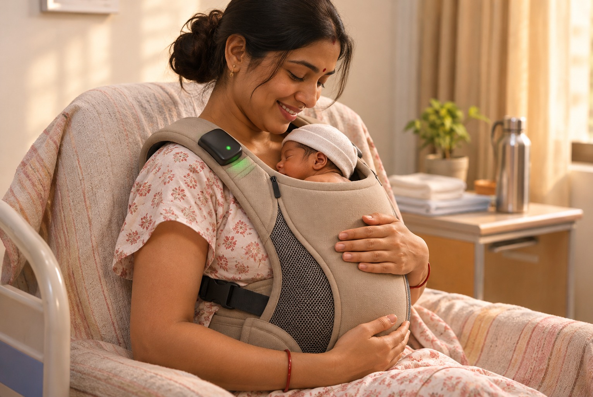
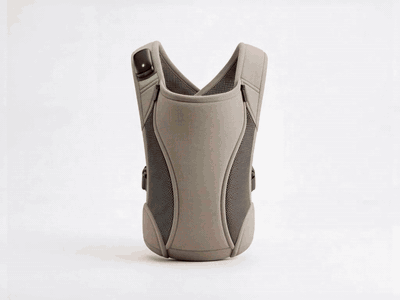
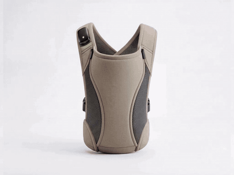
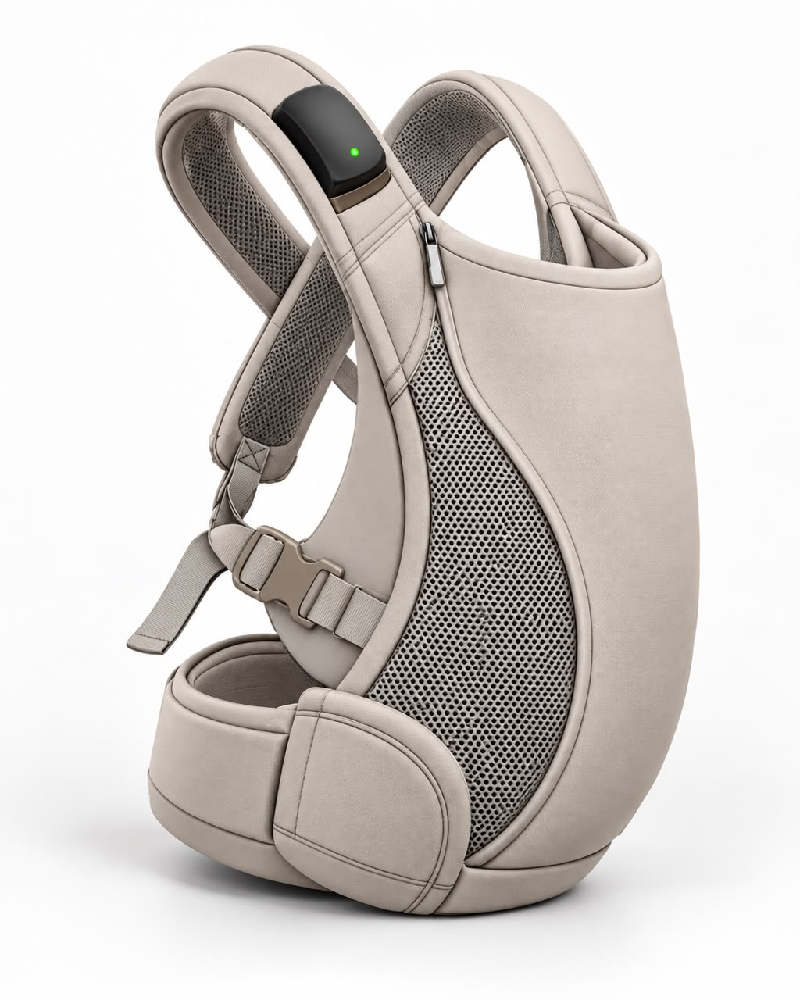
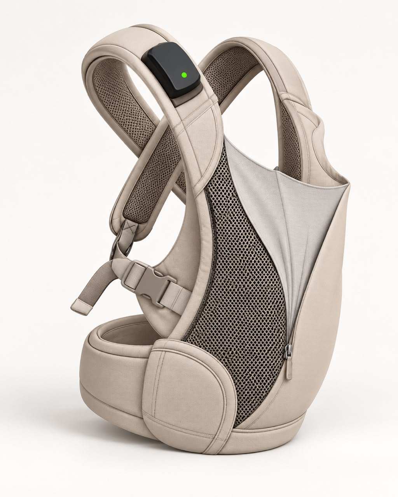

<p align="center">
  
</p>

<p align="center">
  A skin-to-skin baby carrier that keeps watch over a newborn's warmth at home,<br>
  and tells the family, their ASHA worker and the doctor what to do next.
</p>

<p align="center">
  
</p>

---

## About

Newborns, especially small or early babies, can lose heat quickly, and a cold
baby is one of the biggest risks in the first weeks at home. Skin-to-skin
contact keeps them warm. NeoBridge makes it easy and safe: a soft carrier holds
the baby against the mother's chest, and a small sensor on the strap watches
the baby so that a problem is noticed early and the right person is called.

- **The sensor** (ESP32) on the carrier strap reads skin temperature, room
  temperature, heart rate and HRV, and decides the baby's status on its own —
  no phone or internet needed. Its light shows the status at a glance.
- **The mother's app** shows that status as a colour, a shape and a spoken
  sentence, and gives one clear next step. Families never see numbers.
- **The ASHA's app** lists her babies with the ones needing help first, and
  calls the family in one tap.
- **The doctor's view** shows trends, alerts and data quality for a referred baby.

## The product

<table>
  <tr>
    <td align="center" width="50%">
      <a href="assets/video/carrier-in-use.mp4">
        
      </a>
      <br><sub>In use · <a href="assets/video/carrier-in-use.mp4">watch video</a></sub>
    </td>
    <td align="center" width="50%">
      <a href="assets/video/carrier-360.mp4">
        
      </a>
      <br><sub>All around · <a href="assets/video/carrier-360.mp4">watch video</a></sub>
    </td>
  </tr>
  <tr>
    <td align="center">
      
      <br><sub>Sensor clipped to the strap</sub>
    </td>
    <td align="center">
      
      <br><sub>Side zip opens to place the baby</sub>
    </td>
  </tr>
</table>

## Four states, one next step each

| | State | What the family is told |
|---|---|---|
| 🟢 | **Green** — no problem found | Keep baby close and feed often |
| 🟡 | **Yellow** — warm and check | Skin to skin, cover the head, feed; the band checks again in an hour |
| 🔴 | **Red** — get help now | Call your ASHA now; if no answer, call 102 for free transport |
| ⚪ | **Grey** — fix the sensor | Fit it gently or charge it |

## Features

- Pair the sensor over Bluetooth; the phone stays paired and reconnects by itself
- Step-by-step troubleshooting when the sensor can't read
- Works offline: readings are saved on the phone and uploaded when internet returns
- Call buttons open the phone's dialer — ASHA, 102 ambulance, nearest hospital
- English and Hindi, switchable on every screen
- Three roles, three dashboards: mother, ASHA worker, doctor

## How it works

```
 Sensor (ESP32)  ──Bluetooth──▶  Phone app  ──mobile internet──▶  API  ──▶  Database
 senses & decides                saves first,                                Postgres (Neon)
                                 uploads when online
```

## Tech stack

| Part | Built with |
|---|---|
| Mobile app (iOS & Android) | Expo · React Native |
| Website & doctor view | Next.js |
| API | Node · Hono |
| Database | Postgres (Neon) |
| Sensor firmware | ESP32 · ESP-IDF · Bluetooth LE |

## Project structure

```
apps/
  mobile/     iOS & Android app
  web/        website and dashboards
  api/        backend
firmware/     ESP32 sensor
packages/     shared code: Bluetooth protocol, design tokens, translations
assets/       logo, product photos and videos
```

## Getting started

Requires Node 20+ and pnpm.

```bash
pnpm install
pnpm dev:web      # website
pnpm dev:api      # API
pnpm dev:mobile   # mobile app
```

The mobile app uses Bluetooth, so it needs a development build rather than
Expo Go:

```bash
cd apps/mobile
npx expo run:android
```

## Demo logins

| Role | User ID | Password |
|---|---|---|
| Mother | `mother.demo` | `Mother@123` |
| ASHA worker | `asha.demo` | `Asha@123` |
| Doctor | `doctor.demo` | `Doctor@123` |

These are sample accounts for trying the app.

## Status

Early prototype. The sensor's temperature thresholds are placeholders until a
calibration study against a clinical thermometer. NeoBridge supports care
decisions; it does not diagnose.
